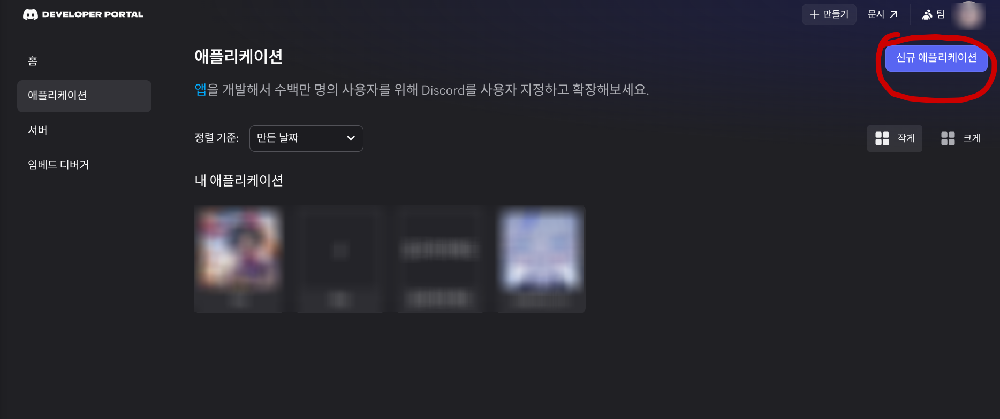
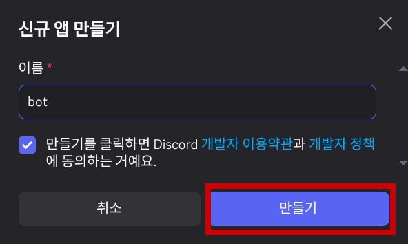
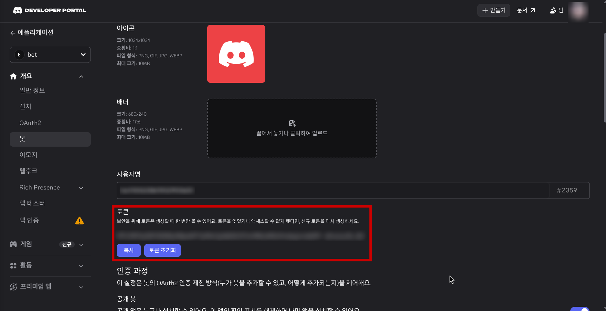
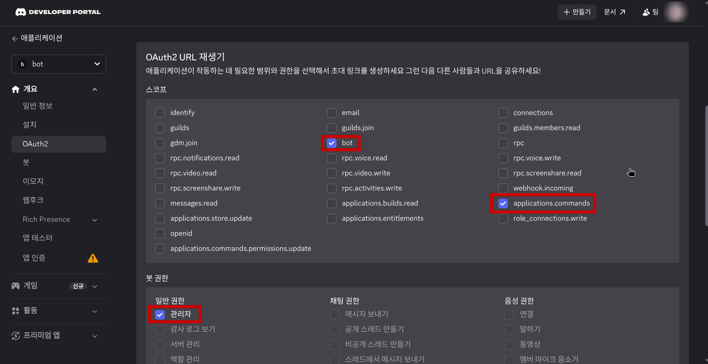
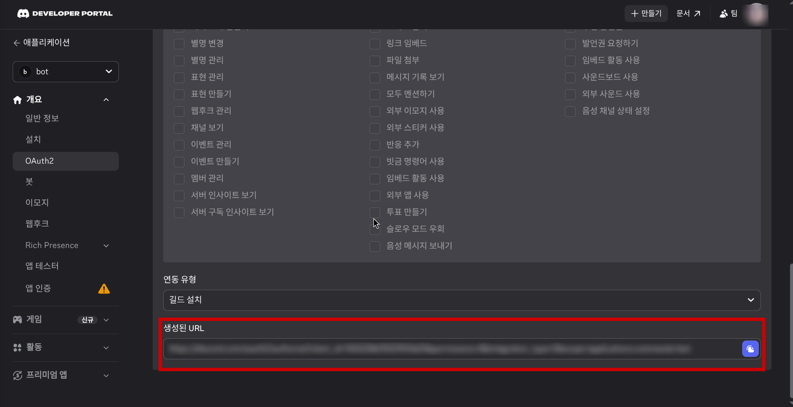
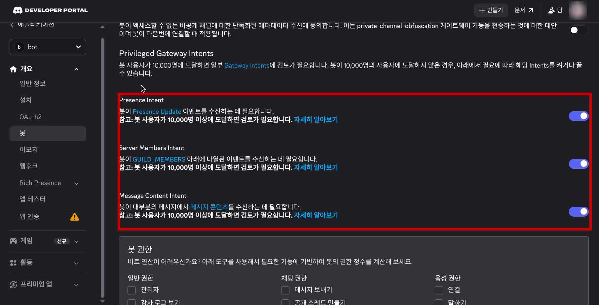
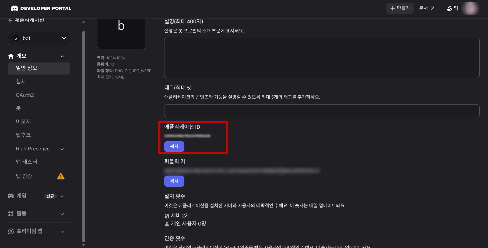
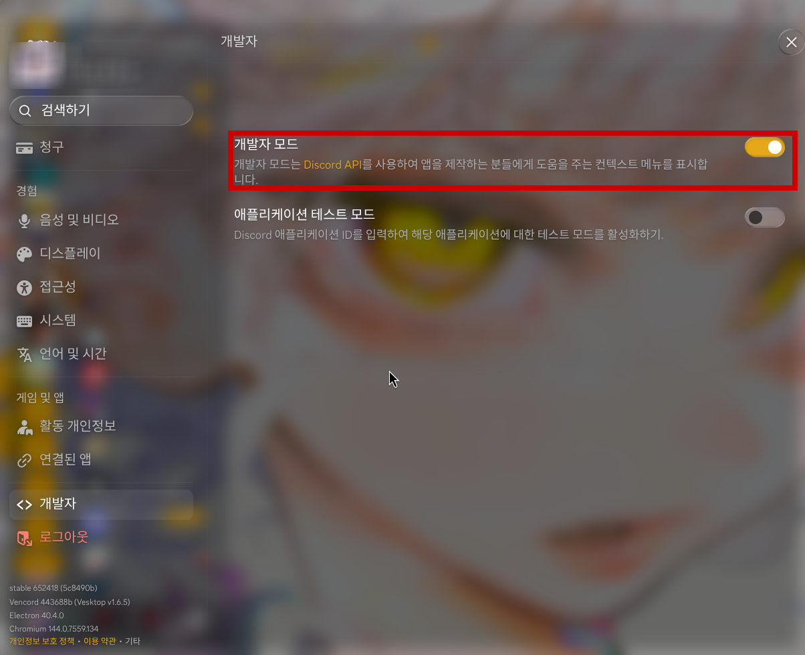
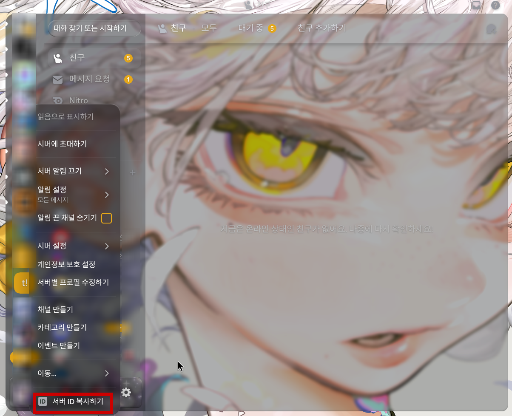
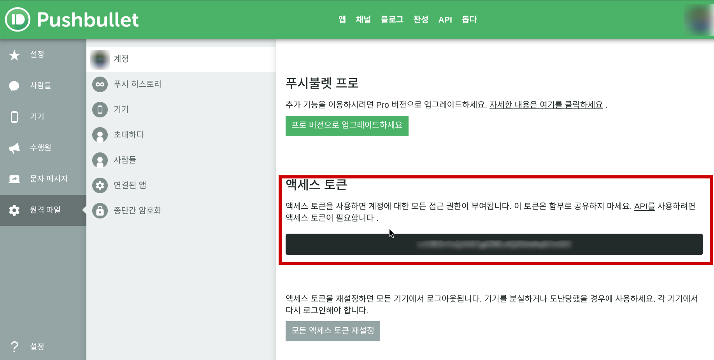

# Discord Shop Bot

<div align="center">
  
</div>

> **Pushbullet 기반 모바일 알림 연동을 활용한 디스코드 상점 자동화 프로젝트** <br/> **Period: 2026.10.24 - 2026.10.29**

## Team

| Name | Role | Affiliation |
| --- | --- | --- |
|  <br> SIMISING | Developer / PM | 1인 프로젝트 |

---

## About Project

본 프로젝트는 디스코드 서버에서 상점을 운영하면서, 사용자의 결제 알림을 핸드폰으로 받아보고 이를 서버와 연결해 자동으로 확인할 수 있도록 만든 프로젝트입니다.

핵심 아이디어는 Pushbullet 라이브러리를 사용해 스마트폰에서 전달되는 입금 알림을 읽고, 해당 내용과 금액, 송금자 정보를 기반으로 결제 여부를 검증하는 것입니다. 이를 통해 서버 운영자는 별도로 수동으로 입금 내역을 확인하지 않고도, 모바일 알림과 디스코드 봇을 연동해 더 빠르게 거래를 처리할 수 있습니다.

즉, 이 프로젝트는 단순한 디스코드 쇼핑 봇이 아니라, 스마트폰 알림과 디스코드 서버를 연결하는 실시간 결제 알림 연동 시스템에 가깝습니다.

#### Key Value or Summary
Pushbullet를 활용해 휴대폰 알림을 서버 운영 로직과 연결하고, 결제 확인과 상점 관리 흐름을 자동화한 프로젝트입니다.

#### Core Features
1. Pushbullet 기반 모바일 알림 수신 및 결제 검증
2. 디스코드 서버 내 상점 상품 관리
3. 포인트 적립, 보유금액 전환, 등급 관리
4. 관리자용 로그 및 재고 관리 기능

---

## Test Environment

본 프로젝트는 실제 모바일 알림 환경을 기반으로 동작하도록 설계되었습니다.

- 모바일 환경 : Android
- 앱 : Toss
- 서버 실행 환경 : Linux

---

## Getting Started

### Requirements

- [Node.js v18.0.0 이상](https://nodejs.org/)
- [npm v9.0.0 이상](https://www.npmjs.com/)
- Discord Bot Token
- Discord Application ID
- Discord Guild ID
- Pushbullet API Key

### Required Libraries

이 프로젝트를 실행하려면 아래 라이브러리를 설치해야 합니다.

```bash
npm install discord.js better-sqlite3 dotenv pushbullet
```

개발 편의를 위해 아래 라이브러리도 함께 설치했습니다.

```bash
npm install -D nodemon
```

### Installation

#### 1) Clone or download the project
```bash
git clone <repository-url>
cd discordbot
```

#### 2) Install dependencies
```bash
npm install
```

#### 3) Set up environment variables
`.env` 파일을 생성하고 아래 값을 입력합니다.

```env
DISCORD_TOKEN=your_discord_bot_token
CLIENT_ID=your_discord_application_id
GUILD_ID=your_discord_server_id
PUSHBULLET_API_KEY=your_pushbullet_key
```

#### 4) Deploy slash commands
```bash
npm run deploy
```

#### 5) Run the bot
```bash
npm start
```

개발 중 확인용으로 실행할 때는:
```bash
npm run dev
```

---

## Stacks

### Environment


### Config


### Development


### Communication


---

## Key Features

### Feature 1: Pushbullet 알림 연동
- 모바일에서 오는 입금 또는 결제 알림을 실시간으로 수신합니다.
- 알림 메시지에 포함된 송금자 이름과 금액을 분석해 결제 정보를 확인합니다.
- 휴대폰 알림을 기반으로 서버 운영자가 빠르게 결제 여부를 확인할 수 있습니다.

### Feature 2: 디스코드 상점 운영
- 관리자는 상품을 등록, 수정, 삭제할 수 있습니다.
- 서버 내에서 상품 판매와 구매 흐름을 직접 운영할 수 있습니다.
- 사용자에게는 간단한 상점 인터페이스로 접근할 수 있습니다.

### Feature 3: 포인트 및 보유금액 관리
- 사용자의 구매 금액에 따라 포인트를 적립하고, 포인트를 보유금액으로 전환할 수 있습니다.
- 등급 기준을 설정해 회원 상태를 관리할 수 있습니다.

### Feature 4: 재고와 로그 관리
- 계정형 상품의 재고를 등록하고, 판매 시 랜덤으로 재고를 추출합니다.
- 구매 이력과 로그 채널을 통해 운영 상황을 추적할 수 있습니다.

---

## Architecture

### Directory Structure

프로젝트는 기능별로 분리되어 있어 구조를 이해하기 쉽고 유지보수가 편하도록 구성되어 있습니다.

```bash
.
├── commands/              # 디스코드 슬래시 커맨드 정의
├── commands/handlers/     # 각 명령의 실제 처리 로직
├── database/              # SQLite DB 연결 및 데이터 처리
├── events/                # 디스코드 이벤트 리스너
├── services/              # 상점, 구매, 재고 관련 비즈니스 로직
├── util/                  # 로그, 버튼, Pushbullet 연동 유틸
├── image/                 # 스크린샷 및 이미지 보관 폴더
├── index.js               # 봇 실행 진입점
├── deploy-commands.js     # 커맨드 배포 스크립트
├── package.json           # 프로젝트 의존성과 실행 스크립트
├── README.md              # 프로젝트 문서
├── hello.txt              # 임시 메모/테스트 파일
└── .env                   # 환경 변수 파일
```

### Component Overview

- commands/: 관리자와 사용자 명령어 정의
- handlers/: 실제 기능 동작 처리 로직
- services/: 구매, 재고, 상품 관리 비즈니스 로직
- database/: 사용자/상품/거래 데이터 저장
- events/: Discord 로그인 및 인터랙션 이벤트 처리
- util/: Pushbullet 알림과 로그 처리

---

## Project Flow

### 1) Discord Developer Portal 접속

<div>
    
    
</div>

- [Discord Developer Portal](https://discord.com/developers/applications)에 접속합니다.
- New Application을 눌러 프로젝트 이름을 설정합니다.
- 생성된 애플리케이션에서 Bot 탭으로 이동합니다.

### 2) 봇 생성 및 토큰 발급

<div>
    
</div>

- Add Bot 버튼을 눌러 봇을 생성합니다.
- Token 항목을 확인하고, 복사해 `.env` 파일의 `DISCORD_TOKEN`에 저장합니다.
- Public Bot 옵션을 적절히 설정하고, 필요한 권한을 추가합니다.

### 3) 서버에 봇 초대

<div>
    
    
    
</div>

- OAuth2 > URL Generator 메뉴로 이동합니다.
- bot 권한을 선택하고, 필요한 서버 권한을 체크합니다.
- 생성된 URL을 접속해 본인 서버에 봇을 초대합니다.

### 4) 앱 ID 확인

<div>
    
</div>

- 디스코드 서버 설정에서 서버 ID를 확인합니다.
- Developer Portal의 General Information에서 Application ID를 확인합니다.
- 이 값을 `.env`의 `CLIENT_ID`에 넣습니다.

### 5) 서버 ID 확인

<div>
    
    
</div>

- 디스코드 설정에서 개발자 모드를 킵니다.
- 디스코드 서버 설정에서 서버 ID를 확인합니다.
- 이 값을 `.env`의 `GUILD_ID`에 넣습니다.


### 6) Pushbullet 연동

<div>
    
</div>

- [Pushbullet](https://www.pushbullet.com/)에 접속합니다.
- 로그인 후 내 계정에서 엑세스 토큰을 생성합니다.
- 이 값을 `.env`의 `PUSHBULLET_API_KEY`에 넣습니다.
- Play 스토어에서 Pushbullet을 다운로드 후 로그인합니다.

---

## Pushbullet 연동 원리

이 프로젝트에서 Pushbullet은 단순한 문자 알림 도구가 아니라, 입금 확인을 자동화하는 핵심 모듈입니다. 실제 동작 흐름은 다음과 같습니다.

1. `.env` 파일에 `PUSHBULLET_API_KEY`를 저장합니다.
2. `util/pushbulletHandler.js`에서 `Pushbullet` 라이브러리를 불러오고, `pusher.stream()`으로 실시간 알림 스트림을 연결합니다.
3. 스마트폰에서 입금 알림이 오면 `stream.on('push', ...)` 이벤트가 발생합니다.
4. 알림의 `title`과 `body`를 합쳐 문자열로 만들고, 숫자만 추출해 금액을 확인합니다.
5. `입금` 또는 `송금` 키워드가 포함되어 있고, 실제 송금자명과 입금 금액이 맞으면 결제 확인으로 처리합니다.
6. 이 조건이 충족되면 서버는 해당 사용자의 포인트 또는 보유 금액을 반영하고, 구매 완료 처리를 이어갑니다.

```javascript
const combinedMessage = `${title} ${body}`.replace(/\s+/g, ' ').trim();
const pureNumbers = combinedMessage.replace(/[^0-9]/g, '');
const hasPaymentKeyword = /입금|송금/.test(combinedMessage);
const hasSender = combinedMessage.includes(sender.trim());
const hasAmount = pureNumbers.includes(amount.toString());

if (hasPaymentKeyword && hasSender && hasAmount) {
  resolve(combinedMessage);
}
```

즉, 이 프로젝트는 휴대폰 알림을 수집하는 방식으로 결제 여부를 확인하고, 확인된 정보를 서버 로직에 연결해 실제 보유 금액을 갱신하는 구조입니다. 이 부분이 바로 본 프로젝트의 핵심 아이디어이자 발표 포인트입니다.

---

## References

- [Discord.js 공식 문서](https://discord.js.org/)
- [Node.js 공식 문서](https://nodejs.org/docs/)
- [npm 공식 문서](https://docs.npmjs.com/)
- [better-sqlite3 GitHub](https://github.com/WiseLibs/better-sqlite3)
- [Pushbullet 공식 문서](https://www.pushbullet.com/)

---

## License

본 프로젝트는 개인 프로젝트로 제작되었으며, 공개 및 발표용으로 활용할 수 있습니다. 다만 다음 사항을 엄수해야 합니다.

- 본 프로젝트는 개발 및 발표 목적을 위한 실험적 프로젝트이며, 실제 운영 환경에서는 일부 버그, 예외 처리 누락, 보안 허점, 또는 동작 차이가 발생할 수 있습니다.
- 본 프로젝트의 소스코드, 이미지, 로고, 디자인 자료는 개인 학습, 포트폴리오, 발표 목적에 한해 사용합니다.
- 상업적 이용, 무단 판매, 재배포, 타인의 저작권 침해 행위는 금지합니다.
- 외부에 공개하는 경우, 원본 제작자 정보와 라이선스 내용을 함께 표시하는 것을 권장합니다.
- 불법적이거나 악의적인 목적의 사용, 불법상업적 이용, 타인 권리 침해 행위는 엄격히 금지합니다.
- 필요 시 MIT License 형태로 정리해 사용할 수 있으나, 해당 라이선스와 상충되는 이용은 허용하지 않습니다.
- 본 프로젝트는 완성형 서비스가 아니라, 지속적인 개선이 필요한 개발 중 프로젝트로 간주됩니다.

본 문서는 발표용 포트폴리오 목적에 맞춰 작성되었으며, 프로젝트 이미지는 본인의 실제 제작 자료 또는 허가된 자료만 사용해야 합니다.

---

## Support

프로젝트 개발을 응원해주신 분들을 위한 후원 링크입니다.

- [후원하기](https://litt.ly/hellos)

> 후원은 프로젝트 유지 및 추가 개발 지원을 위한 용도로 사용됩니다.

---

## Summary

이 프로젝트는 디스코드 서버와 스마트폰 알림을 연결해, 상점 운영과 결제 확인을 더 빠르고 편하게 자동화하는 데 초점을 둔 발표용 프로젝트입니다. 특히 Pushbullet을 활용한 모바일 알림 연동은 본 프로젝트의 핵심 기능이며, 이를 통해 실제 운영 환경에서 유용하게 사용할 수 있는 구조를 구현했습니다.
